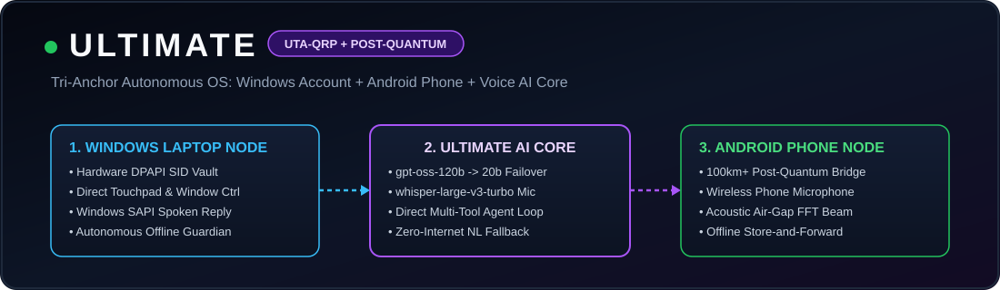

<div align="center">
  
</div>

<div align="center">

**ULTIMATE** is a standalone tri-anchor personal AI operating system that connects a **Windows Laptop Account**, an **Android Phone**, and an **Autonomous AI Voice Core** over local radio, post-quantum 100km+ tunnels, acoustic air-gap links, and zero-internet offline modes.

</div>

---

## Core Architecture

ULTIMATE is built around three cryptographic anchors (`UTA-QRP`):

| Anchor | Component | Implementation |
|---|---|---|
| **1. Windows Laptop Node** | Hardware DPAPI SID enclave + direct screenshot-free desktop control | [`enclave.py`](src/ultimate/security/enclave.py), [`laptop_control.py`](src/ultimate/tools/laptop_control.py) |
| **2. ULTIMATE AI & Voice Core** | Multi-model Groq failover engine + Whisper STT + Windows SAPI laptop speaker output | [`groq_failover.py`](src/ultimate/engine/groq_failover.py), [`speaker.py`](src/ultimate/voice/speaker.py) |
| **3. Android Phone Node** | Mobile control interface (`/ultimate`), wireless phone mic, 100km+ companion bridge, and ADB | [`control_routes.py`](src/ultimate/server/control_routes.py), [`phone_control.py`](src/ultimate/tools/phone_control.py) |

---

## Key Features

### 1. Tri-Anchor Hardware Identity & Ratchet Security (`UTA-QRP`)
- **Windows DPAPI Binding** ([`enclave.py`](src/ultimate/security/enclave.py)): Seals the master seed, pairing API key, and ratchet secret using Windows `CryptProtectData` tied to your logged-in Windows account SID (`whoami /user`) and hardware `MachineGuid`.
- **One-Time Chain Ratchet**: Optional `X-Ult-Nonce`, `X-Ult-Ts`, `X-Ult-Step`, and `X-Ult-Sig` headers enforce replay protection (`HTTP 403` on reused nonces or expired timestamps) with mutual server proof responses.
- **100km+ Post-Quantum Tunnel** ([`launch_ultimate.py`](launch_ultimate.py)): Launches `cloudflared` with `--post-quantum` (`X25519MLKEM768`) when internet is available and generates a mobile pairing QR code.

### 2. Zero-Side-Effect, Screenshot-Free Device Control
- **Direct Laptop Control** ([`laptop_control.py`](src/ultimate/tools/laptop_control.py)):
  - Live browser virtual touchpad (`mouse_delta`), click, double-click, right-click, and scroll
  - Open windows enumeration and focus/minimize/close manager
  - Direct directory and file browser (`list_files`), app launcher and process terminator
  - Volume slider, mute, media playback keys, screen brightness slider, clipboard sync, hotkeys, power/account lock, and PowerShell console
- **Direct Phone Control** ([`phone_control.py`](src/ultimate/tools/phone_control.py)):
  - Browser Companion Bridge (`/v1/control/phone-bridge/sync`) plus optional USB/Wireless ADB (`tools/platform-tools/adb.exe`)
  - Hardware keys, app launching, URL push, calls, SMS composer, and **Find My Phone** siren + vibration alert

### 3. Phone-as-Wireless-Microphone & Spoken Laptop Responses
- Speak into the **Tap to Speak** bar in `/ultimate` from your phone microphone (`MediaRecorder` transcribed by `whisper-large-v3-turbo` or native browser speech recognition).
- Commands run through [`AgentLoop`](src/ultimate/core.py) over `/v1/control/voice-audio`.
- Replies are spoken aloud directly from the laptop speakers using Windows SAPI (`speak_on_laptop_async`).

### 4. Resilient Multi-Model Groq Failover Engine
Implemented in [`src/ultimate/engine/groq_failover.py`](src/ultimate/engine/groq_failover.py):
1. **Primary**: `openai/gpt-oss-120b`
2. **Failover 1**: `openai/gpt-oss-20b`
3. **Failover 2**: `qwen/qwen3.8-27b` (handles HTTP 400 `tool_use_failed` by failing over cleanly)
4. **Zero-Internet Fallback**: Local [`execute_offline_nl_command`](src/ultimate/security/offline_transport.py)

### 5. Offline, Air-Gap & 100km Off-Grid Communication Modes
- **Zero-Internet Local Radio Links**: Scans local Wi-Fi Direct, Mobile Hotspot, Bluetooth PAN, and USB adapters (`get_offline_radio_links`).
- **Acoustic Air-Gap Receiver** ([`offline_transport.py`](src/ultimate/security/offline_transport.py)): FFT frequency detector on the laptop microphone decoding `2450 Hz` preamble + `2800-4000 Hz` command tones emitted from the phone speaker when Wi-Fi and internet are disabled.
- **1-Laptop + 1-Phone Autonomous Guardian** ([`guardian.py`](src/ultimate/security/guardian.py)): Countdown rules, battery-threshold sleep protection, and phone-away dead-man account lock paired with an offline browser Store-and-Forward queue.
- **`ULT1` Off-Grid Ratcheted Packets** ([`offgrid_100km.py`](src/ultimate/security/offgrid_100km.py)): Compact authenticated SMS and LoRa command frames (`ULT1:<step>:<ts>:<nonce>:<sig16>:<command>`).

---

## Installation & Quick Start (Windows)

```powershell
# 1. Create a Python 3.11 virtual environment
uv venv .venv --python 3.11

# 2. Install ULTIMATE and dependencies
uv pip install -e . --python .venv\Scripts\python.exe

# 3. Set your Groq API key
$env:GROQ_API_KEY = "your_groq_api_key"

# 4. Start ULTIMATE (creates DPAPI vault, local radio QR code, and server)
.venv\Scripts\python.exe launch_ultimate.py
```

Optional external binaries (place under `tools/`, ignored by Git):
- `tools/cloudflared.exe` for 100km+ post-quantum global access
- `tools/platform-tools/adb.exe` for USB or Wireless Android ADB control

## License

Licensed under the [MIT License](LICENSE).
